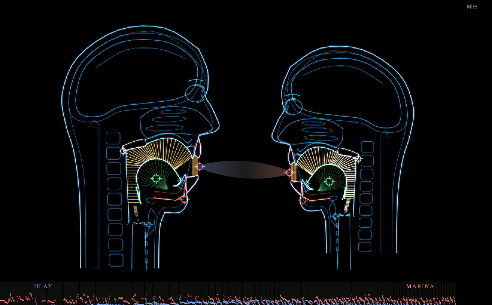

# AAA-AAA（重建）

**尹紫涔 Yin Zicen**
《AAA-AAA（重建）》/ *AAA-AAA (Reconstructed)*
2026
网页，物理声道模型实时合成，机器聆听 · 9分51秒，循环
Web-based work, real-time physical vocal-tract synthesis, machine listening · 9 min 51 sec, loop



未来考古系列的第一件作品。
The first work in an ongoing series on future archaeology.

---

## 作品

1978年2月，玛丽娜·阿布拉莫维奇与乌雷在列日的电视演播室中相对跪坐，向彼此持续发声，在不断逼近中把声音推向嘶哑。这件作品属于两人“关系作品”（Relation Work）时期，是一场以身体在场和真实消耗为前提的耐力性表演。演出时长约15分钟，今天主要以 R.T.B.F. 拍摄的单声道录像流传。

本作把这份录像当作唯一的物证。艺术家以机器聆听的方式解析录音，提取出六十七次发声与换气、两条随时间攀升的音高，以及嗓音开始失稳的节点，并整理成一份可以执行的乐谱，交由开源物理声道模型 CHIMERA 再表演。片头由阿布拉莫维奇朗读的作品说明，也被重建为合成朗读，与原录音逐词对齐。屏幕上，两具剖面式的声道相对发声，其中的气流、压力与口型都由模型实时演算。

作品借用未来考古的视角，设想这件表演在后人类时代被重新读取。那时的观看者，或许已经与技术深度融合，或许以具身智能等非人的形态存在。呼吸与疲惫对它而言不再是共享的经验；要进入这场表演，它必须先为自己搭建一具可以发声的身体。重建在机制层面可以做到相当精确，而原作赖以成立的身体经验，恰恰在这个过程中被悬置了。

机器聆听在这里也碰到了自身的边界。大约两分钟之后，两人的声音在单声道录音中已无法分离。阿布拉莫维奇与乌雷曾用“That Self”指称两人关系中生成的第三个存在，这段无法拆分的声音，是重建所能捕捉到的、与它最接近的痕迹。

## The work

In February 1978, Marina Abramović and Ulay knelt facing each other in a television studio in Liège and sustained a vocal sound towards one another, drawing closer until their voices broke. Part of their *Relation Work* period, the piece was a durational performance premised on bodily presence and real exhaustion. The fifteen-minute performance survives chiefly as a mono video recording made by R.T.B.F.

This work treats that recording as its sole piece of evidence. Through machine listening, the artist extracted sixty-seven phrases and breaths, two pitch lines that climb over time, and the points at which the voices begin to fail, and organised them into an executable score for re-performance by CHIMERA, an open-source physical model of the human vocal tract. Abramović's spoken introduction is likewise reconstructed as a synthetic reading, aligned word by word to the original. On screen, two cross-sectional vocal tracts face each other; their airflow, pressure and mouth shapes are computed in real time.

Taking the position of a future archaeology, the work imagines the performance being read again in a posthuman era. Its viewer may by then be deeply entangled with technology, or exist as an embodied intelligence of a non-human kind. For such a viewer, breath and fatigue are no longer shared experience; to enter the performance, it must first build itself a body that can produce sound. The reconstruction can be precise at the level of mechanism, while the bodily experience on which the original depends is held in suspension.

Machine listening also meets its own limit here. After about two minutes, the two voices can no longer be separated in the mono recording. Abramović and Ulay used the term "That Self" for a third entity generated within their relationship; this inseparable sound is the closest trace of it the reconstruction can register.

---

## 观看 / Viewing

网页需要通过本地服务器打开（AudioWorklet 和 WebAssembly 不能直接双击打开）。
The page must be served over HTTP (AudioWorklet and WebAssembly do not run from `file://`).

```bash
npx serve .
# 打开终端显示的地址 / open the address shown
```

- 请佩戴耳机：左声道 Ulay，右声道 Marina。/ Headphones recommended: Ulay left, Marina right.
- **重建 / 档案**：载入档案影像后，可在重建的声音与 1978 年的原声之间切换。/ After loading the archive film, switch between the reconstructed sound and the 1978 sound.
- **经由旧介质**：让重建的声音经过拟合出的 1978 年电视录音频响。/ Passes the reconstruction through the fitted response of the 1978 broadcast recording.

本仓库**不包含**原作录像或录音。观众需自行合法取得档案影像，在页面左侧载入（只在本机播放，不会上传）；或将其命名为 `original.mp4` 放在 `index.html` 旁边。
This repository does **not** contain the original recording. To compare, obtain the archive film through legitimate channels and load it in the page (it plays locally only), or place it next to `index.html` as `original.mp4`.

## 仓库结构 / Contents

| 路径 / Path | 内容 / What it is |
|---|---|
| `index.html`, `core.js`, `driver.js`, `worklet.js` | 作品网页；`driver.js` 把乐谱映射为声道参数（肺压、声带张力、气声、粗糙度、口型、换气） / the work; `driver.js` maps the score to vocal-tract controls |
| `score.json` | 从录音中提取的 25 Hz 乐谱：发声与换气、两条音高、发声清晰度、用力程度 / the 25 Hz score extracted from the recording |
| `intro_plan.json` | 片头朗读的发音动作，按原录音逐词对齐 / articulatory plan of the spoken introduction, word-aligned to the recording |
| `chimera.wasm`, `heads/` | CHIMERA 声音引擎与头部剖面渲染器（未经修改，从源码编译与打包） / CHIMERA engine and cutaway renderer, built unmodified from source |
| `analysis/` | 机器聆听：音高显著度、两声部追踪、乐谱生成、拟合与对照 / machine-listening scripts |
| `tools/` | 离线渲染与视频合成脚本 / offline rendering and video scripts |
| `docs/` | 静帧与频谱对照图 / stills and the archive-vs-reconstruction spectrogram |

分析脚本默认读取 `analysis/audio.wav`（由原录像提取，未包含在仓库中）。
The analysis scripts expect `analysis/audio.wav`, extracted from the archive film and not included here.

## 方法与不确定 / Method and uncertainty

- 原录音实际上是单声道。约两分钟后，低声部的第二谐波与高声部的基频几乎重合，两条音高的归属只能按连续性推断；最后约三分钟两条线缠在一起，归属更不确定。
  The recording is effectively mono. After about two minutes the lower voice's second harmonic coincides with the upper voice's fundamental; the assignment of the two pitch lines is inferred from continuity and is uncertain, especially in the final three minutes.
- 1978 年电视录音的自动增益抹平了响度起伏，用力程度由频谱亮度间接估计，并经一轮“合成—再分析”校正。
  Broadcast gain control flattened the dynamics; effort is estimated from spectral brightness and corrected by one round of analysis-by-synthesis.
- 片头文字经离线语音识别确认、强制对齐，再由 CHIMERA 的英语语音规划器生成。声音为通用女性声道模板，并非艺术家本人的嗓音。
  The introduction was recognised offline, force-aligned, and voiced by CHIMERA's speech planner using a generic female vocal-tract template, not the artist's own voice.
- 换气时的口型参照原录像：前几口气闭口经鼻吸入，约 1:00–1:50 逐渐闭不严，此后张口喘气。
  Breathing follows the archive film: closed-mouth nasal breaths at first, loosening between about 1:00 and 1:50, open-mouthed gasps thereafter.

## 版权 / Copyright and credits

- **本作品** © 2026 尹紫涔 Yin Zicen。作品的观念、文字、视觉构成与影像版本保留所有权利；本仓库中由作者编写的代码以 MIT 许可发布。详见 [LICENSE](LICENSE) 与 [LICENSE-CODE.txt](LICENSE-CODE.txt)。
  **This work** © 2026 尹紫涔 Yin Zicen. The concept, texts, visual composition and video versions are all rights reserved; code written by the author in this repository is released under the MIT License. See [LICENSE](LICENSE) and [LICENSE-CODE.txt](LICENSE-CODE.txt).
- **原作**：Marina Abramović & Ulay, *AAA-AAA*, 1978. 录像由 R.T.B.F. 于列日拍摄制作。原作及其录像的权利归各自权利人所有。本仓库不包含原作录像或录音，仅包含从中分析得到的数据，以及艺术家文字说明的简短引用，用于研究与评论。
  **Original work**: Marina Abramović & Ulay, *AAA-AAA*, 1978. Video recorded and produced by R.T.B.F., Liège. All rights in the original work and its recording belong to their respective holders. This repository contains no part of the recording itself, only data derived from analysing it and a brief quotation of the artists' statement, for research and commentary.
- **声音引擎与头部剖面渲染器**：[CHIMERA](https://github.com/jamesondh/chimera-vocal-synth)，© 2026 Jameson Hodge，MIT License（见 [CHIMERA-LICENSE.txt](CHIMERA-LICENSE.txt)）。
  **Sound engine and cutaway renderer**: [CHIMERA](https://github.com/jamesondh/chimera-vocal-synth), © 2026 Jameson Hodge, MIT License (see [CHIMERA-LICENSE.txt](CHIMERA-LICENSE.txt)).

完整的第三方声明见 [NOTICE.md](NOTICE.md)。/ Full third-party notices: [NOTICE.md](NOTICE.md).
